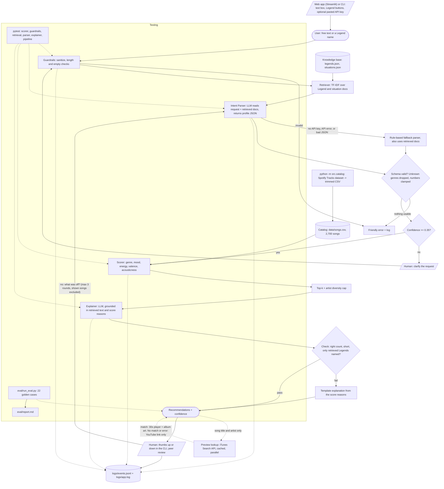

# System Diagram

Rectangles with slanted sides (`[/ /]`) are **human checkpoints**. The `Testing` box shows where automated tests and the evaluation harness check the AI. Dotted arrows are logging.

## Where the AI is checked

| Checkpoint | Type | What it catches |
|---|---|---|
| Input guardrails | automatic | empty, oversized, or control-character input |
| Schema validation | automatic | LLM output with unknown genres or moods, out-of-range numbers, missing fields |
| Rule-based fallback | automatic | API failure, missing key, non-JSON reply |
| Confidence threshold | automatic, then human | vague or unrecognized requests; the user is asked to clarify |
| Explanation check | automatic | wrong count, oversized text, or a Legend that was never retrieved |
| Golden-case evaluation | automated test | regressions in end-to-end behavior |
| Thumbs up/down, peer review | human | relevance problems no automatic check can see |
| Pasted API key check | automatic | one tiny test call; a bad key is reported at once and the app stays in offline mode |
| Preview matching | automatic | wrong artist or song, non-Apple URLs, timeouts and bad JSON all fall back to the YouTube link |
| Hosted-log privacy | automatic | the web app redacts what visitors type (`LOG_REQUEST_TEXT=0`) |
| "What was off?" follow-up | human, then automatic | a "no" re-runs the request with the user's note and never repeats shown songs |
